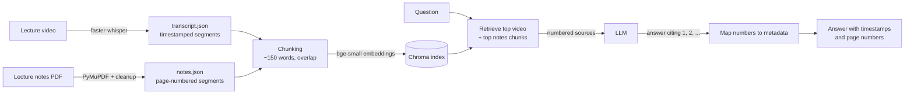

# Footnote

Ask questions about your lecture videos and notes, and get answers that cite the exact **timestamp** or **page** they came from.

Footnote is a retrieval-augmented generation (RAG) study assistant. It transcribes lecture recordings with Whisper, extracts lecture notes from PDFs, indexes both in a vector database, and answers questions with an LLM that may only use the retrieved sources. **Every citation is produced from stored metadata, never written by the LLM**, so timestamps and page numbers can't be made up.

## Example

```
$ python -m footnote.qa --course 6.006 what is a peak in an array

In a one-dimensional array, a peak is a local property: an element is a peak if it is greater than or equal to both its left and right neighboring elements [1]. For example, given an array of elements $a$ through $i$, position 2 (element $b$) is a peak if and only if $b \ge a$ and $b \ge c$ [1][5]. At the edges of an array, an element only compares to its single neighbor; for instance, the last position (position 9, element $i$) is a peak if $i \ge h$ [1][5].

Sources:
  [1] 6.006 · lec01 video 16:24-17:38
  [5] 6.006 · lec01 notes pp. 2-3
```

Out-of-scope questions are refused instead of answered from the model's general knowledge:

```
$ python -m footnote.qa --course 6.006 what is dijkstras algorithm
I couldn't find this in the lectures or notes.
```

## How it works



1. **Transcribe**: faster-whisper (`small`, int8, CPU) turns each lecture video into timestamped segments.
2. **Extract notes**: PyMuPDF pulls page-numbered text blocks from the notes PDFs, then a cleanup pass fixes Unicode ligatures (`fi` → `fi`) and removes headers/footers, license pages, diagram labels and repeated slide text.
3. **Chunk**: neighbouring segments are grouped into ~150-word chunks with overlap; each chunk keeps its course, lecture, and time range or page range.
4. **Index**: chunks are embedded with `BAAI/bge-small-en-v1.5` (local) and stored in Chroma.
5. **Answer**: the question retrieves the best video *and* notes chunks, which are sent to the LLM as numbered sources. The LLM cites numbers only; Footnote turns those into real timestamps and pages.

## Design decisions

- **Citations come from metadata, not the model.** The LLM never sees timestamps, so it can't invent them; cited source numbers are checked and invalid ones are flagged.
- **JSON is the source of truth; the vector index is derived.** Transcripts and notes are stored as JSON and committed; the index is rebuilt from them in seconds.
- **Idempotent, cached ingestion.** Outputs record a SHA-256 of their input plus the settings used (Whisper model, parser version), so re-running skips finished work and changing the parser re-processes automatically.
- **Per-source retrieval.** Video chunks outnumber notes chunks about 8 to 1 and were crowding notes out of results, so video and notes are retrieved separately and merged.
- **Grounded answers with an explicit refusal** when the sources don't cover the question.
- **Provider-agnostic LLM layer.** Only `footnote/llm.py` talks to a provider; the model is set in `.env` (currently `gemma-4-31b-it` via the Gemini API). Errors fail loudly: rate limits are retried with exponential backoff, a used-up daily quota stops immediately, and an empty reply is an error, never an empty answer.
- **Measured, not assumed.** A labelled evaluation set checks retrieval, answers, citations and refusals; every run is saved with the settings that produced it.
- **Multi-course.** Each course lives in its own folder with a `course.json`; one shared index with course filters; `--course` limits search to one course.

## Results

Evaluated on a hand-labelled set of 24 questions about MIT 6.006 lectures 1–3: 19 answerable from the lectures or notes, 4 out-of-scope (topics never covered) and 1 answerable only from a slide diagram. Each answerable question records where the answer lives (video time range and/or notes page).

| Metric | Result |
|---|---|
| Retrieval hit rate (right passage among the 6 retrieved) | 19/19 (100%) |
| Mean reciprocal rank (MRR) | 0.835 |
| Answer cites a correct source | 18/18 (100%) |
| Answer contains the key facts (keyword check) | 17/18 (94%) |
| Out-of-scope questions refused | 4/4 (100%) |
| Answerable questions wrongly refused | 0/18 |
| Citations to non-existent sources | 0/23 |
| Diagram-only question | 0/1 (diagrams not yet supported) |

Retrieval metrics cover all 19 answerable questions and use no LLM. Answer metrics come from the most complete run with `gemma-4-31b-it` (23 of 24 questions; one failed with a provider server error). A second run completed 11 questions before repeated provider errors; all 11 were correct and correctly cited, including the one that failed in the first run. The one keyword miss explains the merge step of merge sort with the correct citation but never says that it compares the two front elements.

Speech-to-text, against the official MIT transcript (first 5 minutes of lecture 1, 623 words, MacBook Air CPU):

| Whisper model | Word error rate | Speed |
|---|---|---|
| tiny | 6.9% | ~40× real time |
| **small** (used) | **3.9%** | ~9× real time |

Corpus: 3 lectures (~2.6 hours of video, ~20,800 transcribed words) plus notes → 171 chunks.

**Caveats:** the set is small (one question is about 5 points), it was written by the developer, and LLM answers vary between runs. The keyword check is strict and can miss correctly worded answers; an LLM-based grader is on the roadmap.

**What error analysis found** (each was fixed before the numbers above):

- A retry bug turned rate-limit errors into empty "answers" that were scored as wrong; errors now fail loudly.
- Array notation like `a[0]` in answers was parsed as a citation.
- LaTeX in answers (`\log n`) hid correct facts from the keyword check.
- 2 of 19 gold labels pointed to the wrong place in the lecture and were corrected after checking the video.

## Tuning: chunk size

Chunk size was chosen with a controlled sweep: only the chunk size changes; the questions,
embedding model, overlap and number of retrieved chunks (4 video + 2 notes) stay fixed.

| Words per chunk | Chunks | Median video citation span | Hit rate | MRR |
|---|---|---|---|---|
| 75 | 375 | 33 s | 18/19 | 0.732 |
| 100 | 268 | 44 s | 18/19 | 0.791 |
| **150 (used)** | **171** | **65 s** | **19/19** | **0.835** |
| 250 | 100 | 110 s | 18/19 | 0.705 |
| 400 | 61 | 179 s | 19/19 | 0.802 |

150 words gave the best ranking and full recall while keeping video citations to about a
minute. Larger chunks match questions about as often, but each citation then covers several
minutes and the prompt sent to the LLM grows about 2.7×. With 19 questions, MRR differences
under ~0.05 are within noise.

Reproduce with `python -m scratch.chunk_sweep`.

## Setup

```bash
conda create -n footnote python=3.11
conda activate footnote
pip install -r requirements.txt
cp .env.example .env        # add your Gemini API key and a model name, e.g. gemma-4-31b-it
```

Processed transcripts and notes for MIT 6.006 lectures 1–3 are included, so you can try it without downloading any video:

```bash
python -m footnote.index build
python -m footnote.qa --course 6.006 what is a peak in an array
```

Run the evaluation:

```bash
python -m footnote.evaluate retrieval   # search only: fast, no LLM calls
python -m footnote.evaluate full        # full Q&A: one LLM call per question
```

### Adding a course

```
data/courses/<course-id>/
  course.json              {"name": "...", "language": "en"}
  raw/lec01/video.mp4
  raw/lec01/notes.pdf
```

```bash
python -m footnote.transcribe <course-id>
python -m footnote.ingest_notes <course-id>
python -m footnote.index build
```

## Project layout

```
footnote/
  transcribe.py     video → timestamped segments (faster-whisper)
  ingest_notes.py   notes PDF → page-numbered segments (PyMuPDF)
  chunking.py       segments → retrieval-sized chunks
  index.py          embeddings + Chroma; search and citations
  llm.py            the only module that talks to an LLM provider
  qa.py             retrieval + prompt + citation checking (CLI)
  evaluate.py       evaluation: retrieval and end-to-end metrics
  utils.py          hashing, atomic writes, caching, course discovery
eval/
  questions.jsonl   labelled evaluation questions
  results/          saved runs, each with the settings used
scratch/            experiments (Whisper benchmark, WER measurement, labelling helper)
data/courses/       one folder per course (raw media is git-ignored)
```

## Known limitations

- Diagrams and figures in notes are not understood yet (text only); a diagram-only question gets a confident but wrong answer instead of a refusal.
- Math in PDFs extracts imperfectly (e.g. Θ(n²) becomes "(n2)").
- Video citations point to a ~1-minute range, not the exact sentence.
- The embedding model is English-only.
- Answers contain LaTeX (`$\Theta(n)$`), which renders in a web UI but shows as raw text in the terminal.
- On the Gemini API free tier, requests are rate-limited, hosted models sometimes return server errors at busy times, and Google may use inputs to improve its products; don't use it with private material.

## Roadmap

- **Figures**: render diagram pages and describe them with a vision model.
- **Better grading**: an LLM-based grader alongside the keyword check, and repeated runs at temperature 0.
- **Tuning**: compare chunk sizes and try hybrid (keyword + embedding) search.
- **Local mode**: run fully offline with Gemma via Ollama, and compare it with the hosted model.
- **Web UI** with rendered math and clickable timestamps.
- **Multi-user**: separate storage and index per user.

## Data and license

Lecture videos, transcripts and notes are from [MIT OpenCourseWare 6.006 Introduction to Algorithms (Fall 2011)](https://ocw.mit.edu/courses/6-006-introduction-to-algorithms-fall-2011/) by Srini Devadas and Erik Demaine, shared under a Creative Commons BY-NC-SA license. The processed files in `data/courses/6.006/processed/` are derived from that material and shared under the same license. Content marked as third-party (e.g. "Courtesy of MIT Press") is excluded. Code is under the MIT License (see `LICENSE`).