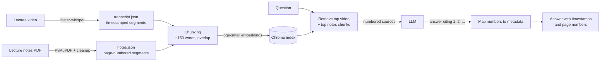

# Footnote

Ask questions about your lecture videos and notes, and get answers that cite the exact **timestamp** or **page** they came from.

Footnote is a retrieval-augmented generation (RAG) study assistant. It transcribes lecture recordings with Whisper, extracts lecture notes from PDFs, indexes both in a vector database, and answers questions with an LLM that may only use the retrieved sources. **Every citation is produced from stored metadata, never written by the LLM**, so timestamps and page numbers can't be made up.

## Example

```
$ python -m footnote.qa --course 6.006 what is a peak in an array

In a one-dimensional array, a peak is a local property: an element is a peak if itis greater than or equal to both its left and right neighboring elements [1]. For example, given an array of elements $a$ through $i$, position 2 (element $b$) is a peak if and only if $b \ge a$ and $b \ge c$ [1][5]. At the edges of an array, an element only compares to its single neighbor; for instance, the last position (position 9, element $i$) is a peak if $i \ge h$ [1][5].

Sources:
  [1] 6.006 · lec01 video 16:24-17:38
  [5] 6.006 · lec01 notes pp. 2-3
```

Out-of-scope questions are refused instead of answered from the model's general knowledge:

```
$ python -m footnote.qa --course 6.006 what is dijkstras algorithm
I couldn't find this in the lectures or notes.
```

## How it works



1. **Transcribe**: faster-whisper (`small`, int8, CPU) turns each lecture video into timestamped segments.
2. **Extract notes**: PyMuPDF pulls page-numbered text blocks from the notes PDFs, then a cleanup pass fixes Unicode ligatures (`fi` → `fi`) and removes headers/footers, license pages, diagram labels and repeated slide text.
3. **Chunk**: neighbouring segments are grouped into ~150-word chunks with overlap; each chunk keeps its course, lecture, time range or page range.
4. **Index**: chunks are embedded with `BAAI/bge-small-en-v1.5` (local) and stored in Chroma.
5. **Answer**: the question retrieves the best video *and* notes chunks, which are sent to the LLM as numbered sources. The LLM cites numbers only; Footnote turns those into real timestamps and pages.

## Design decisions

- **Citations come from metadata, not the model.** The LLM never sees timestamps, so it can't invent them; cited source numbers are checked and invalid ones are flagged.
- **JSON is the source of truth; the vector index is derived.** Transcripts and notes are stored as JSON and committed; the index is rebuilt from them in seconds.
- **Idempotent, cached ingestion.** Outputs record a SHA-256 of their input plus the settings used (Whisper model, parser version), so re-running skips finished work and changing the parser re-processes automatically.
- **Per-source retrieval.** Video chunks outnumber notes chunks ~8 to 1 and were crowding notes out of results, so video and notes are retrieved separately and merged.
- **Grounded answers with an explicit refusal** when the sources don't cover the question.
- **Provider-agnostic LLM layer.** Only `footnote/llm.py` talks to a provider (currently Gemini); the model name lives in `.env`.
- **Multi-course.** Each course lives in its own folder with a `course.json`; one shared index with course filters; `--course` limits search to one course.

## Results so far

Speech-to-text, measured against the official MIT transcript (first 5 minutes of lecture 1, 623 words, MacBook Air CPU):

| Whisper model | Word error rate | Speed |
|---|---|---|
| tiny | 6.9% | ~40× real time |
| **small** (used) | **3.9%** | ~9× real time |

Corpus: 3 lectures (~2.6 hours of video, ~20,800 transcribed words) plus notes → 171 chunks.

Early sanity checks: for each test question, the top search result came from the correct lecture, and an out-of-scope question was correctly refused. A larger evaluation set is in progress (see Roadmap).

## Setup

```bash
conda create -n footnote python=3.11
conda activate footnote
pip install -r requirements.txt
cp .env.example .env        # add your Gemini API key and a Flash model name
```

Processed transcripts and notes for MIT 6.006 lectures 1–3 are included, so you can try it without downloading any video:

```bash
python -m footnote.index build
python -m footnote.qa --course 6.006 what is a peak in an array
```

### Adding a course

```
data/courses/<course-id>/
  course.json              {"name": "...", "language": "en"}
  raw/lec01/video.mp4
  raw/lec01/notes.pdf
```

```bash
python -m footnote.transcribe <course-id>
python -m footnote.ingest_notes <course-id>
python -m footnote.index build
```

## Project layout

```
footnote/
  transcribe.py     video → timestamped segments (faster-whisper)
  ingest_notes.py   notes PDF → page-numbered segments (PyMuPDF)
  chunking.py       segments → retrieval-sized chunks
  index.py          embeddings + Chroma; search and citations
  llm.py            the only module that talks to an LLM provider
  qa.py             retrieval + prompt + citation checking (CLI)
  utils.py          hashing, atomic writes, caching, course discovery
scratch/            experiments (Whisper benchmark, WER measurement)
data/courses/       one folder per course (raw media is git-ignored)
```

## Known limitations

- Diagrams and figures in notes are not understood yet (text only).
- Math in PDFs extracts imperfectly (e.g. Θ(n²) becomes "(n2)").
- Video citations point to a ~1-minute range, not the exact sentence.
- The embedding model is English-only.
- On the Gemini free tier, Google may use inputs to improve its products; don't use it with private material.

## Roadmap

- **Evaluation**: a question set (including figure-only and out-of-scope questions) measuring retrieval hit rate, answer correctness, citation validity and refusal accuracy; use it to tune chunk size.
- **Figures**: render diagram pages and describe them with a vision model.
- **Local mode**: run fully offline with Gemma via Ollama.
- **Web UI** with clickable timestamps.
- **Multi-user**: separate storage and index per user.

## Data and license

Lecture videos, transcripts and notes are from [MIT OpenCourseWare 6.006 Introduction to Algorithms (Fall 2011)](https://ocw.mit.edu/courses/6-006-introduction-to-algorithms-fall-2011/) by Srini Devadas and Erik Demaine, shared under a Creative Commons BY-NC-SA license. The processed files in `data/courses/6.006/processed/` are derived from that material and shared under the same license. Content marked as third-party (e.g. "Courtesy of MIT Press") is excluded. Code is under the MIT License (see `LICENSE`).