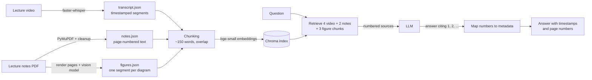

# Footnote

Ask questions about your lecture videos and notes, and get answers that cite the exact **timestamp** or **page** they came from, including diagrams.

Footnote is a retrieval-augmented generation (RAG) study assistant. It transcribes lecture recordings with Whisper, extracts lecture notes from PDFs, describes the diagrams on note and slide pages with a vision model, indexes all of it in a vector database, and answers questions with an LLM that may only use the retrieved sources. **Every citation is produced from stored metadata, never written by the LLM**, so timestamps and page numbers can't be made up.

## Example

```
$ python -m footnote.qa --course 6.006 what is a peak in an array

In a one-dimensional array, a peak is a local property: an element is a peak if it is greater than or equal to both its left and right neighboring elements [1]. For example, given an array of elements $a$ through $i$, position 2 (element $b$) is a peak if and only if $b \ge a$ and $b \ge c$ [1][5]. At the edges of an array, an element only compares to its single neighbor; for instance, the last position (position 9, element $i$) is a peak if $i \ge h$ [1][5].

Sources:
  [1] 6.006 · lec01 video 16:24-17:38
  [5] 6.006 · lec01 notes pp. 2-3
```

Diagrams count as sources too. The answer to this question exists only as a drawing in the lecture 1 notes (taken from the evaluation run):

> **Q:** In the lecture 1 notes, what example array is drawn for the straightforward peak-finding algorithm, and where are its peaks?
>
> **A:** In the lecture 1 notes, the example array drawn for peak examples contains 8 cells with the numbers 6, 7, 4, 3, 2, 1, 4, 5 [7]. The peaks in this array are the values 7 and 5 [7].
>
> [7] 6.006 · lec01 notes p. 2 (figure)

Out-of-scope questions are refused instead of answered from the model's general knowledge:

```
$ python -m footnote.qa --course 6.006 what is dijkstras algorithm
I couldn't find this in the lectures or notes.
```

## How it works



1. **Transcribe**: faster-whisper (`small`, int8, CPU) turns each lecture video into timestamped segments.
2. **Extract notes**: PyMuPDF pulls page-numbered text blocks from the notes PDFs, then a cleanup pass fixes Unicode ligatures (`fi` → `fi`) and removes headers/footers, license pages, diagram labels and repeated slide text.
3. **Describe figures**: notes and slide pages are rendered as images, and a vision model describes what text extraction misses (drawn arrays, trees, grids, arrows, formulas), one segment per diagram. See [Figures](#figures-diagrams-and-slides).
4. **Chunk**: neighbouring text segments are grouped into ~150-word chunks with overlap; each diagram stays its own chunk. Every chunk keeps its course, lecture, and time range or page.
5. **Index**: chunks are embedded with `BAAI/bge-small-en-v1.5` (local) and stored in Chroma.
6. **Answer**: the question retrieves the best video, notes *and* figure chunks, which are sent to the LLM as numbered sources. The LLM cites numbers only; Footnote turns those into real timestamps and pages.

## Design decisions

- **Citations come from metadata, not the model.** The LLM never sees timestamps, so it can't invent them; cited source numbers are checked and invalid ones are flagged.
- **JSON is the source of truth; the vector index is derived.** Transcripts, notes and figure descriptions are stored as JSON and committed; the index is rebuilt from them in seconds.
- **Idempotent, cached ingestion.** Outputs record a SHA-256 of their input plus the settings used (Whisper model, parser version, vision model, prompt version), so re-running skips finished work and changing a setting re-processes automatically.
- **Per-source retrieval.** Video chunks outnumber notes chunks about 8 to 1, and diagram descriptions score lower than plain text, so each source type gets its own seats (4 video, 2 notes, 3 figures) and the results are merged by score.
- **Grounded answers with an explicit refusal** when the sources contain nothing relevant; partial answers say what is missing.
- **Provider-agnostic LLM layer.** Only `footnote/llm.py` talks to a provider; the model is set in `.env`: hosted `gemma-4-31b-it` via the Gemini API, or a local Gemma model via Ollama. Errors fail loudly: server errors and rate limits are retried with exponential backoff, a used-up daily quota stops immediately, and an empty reply is an error, never an empty answer.
- **Measured, not assumed.** A labelled evaluation set checks retrieval, answers, citations and refusals; every run is saved with the settings that produced it.
- **Multi-course.** Each course lives in its own folder with a `course.json`; one shared index with course filters; `--course` limits search to one course.

## Results

Evaluated on a hand-labelled set of 25 questions about MIT 6.006 lectures 1–3: 19 answerable from the lecture video or notes text, 2 answerable only from a diagram, and 4 out-of-scope (topics never covered). Each answerable question records where the answer lives (video time range and/or notes page).

| Metric | Result |
|---|---|
| Retrieval hit rate, text questions (right passage among the retrieved sources) | 19/19 (100%) |
| Mean reciprocal rank (MRR), text questions | 0.835 |
| Retrieval hit rate, diagram questions (right diagram retrieved) | 2/2 |
| Answer contains the key facts (keyword check) | 19/19 text, 2/2 diagram |
| Answer cites a correct source | 19/19 (100%) |
| Out-of-scope questions refused | 4/4 (100%) |
| Answerable questions wrongly refused | 0/19 |
| Citations to non-existent sources | 0/25 |

Retrieval metrics use no LLM. Answer metrics come from one complete run with `gemma-4-31b-it` (all 25 questions, `eval/results/20261020-224903-full.json`); a local Gemma 4 26B scored identically (see [Local vs hosted](#local-vs-hosted)). An earlier run, before diagrams were supported, missed one keyword check: it explained the merge step of merge sort with the correct citation but never said that it compares the two front elements. LLM answers vary between runs.

Speech-to-text, against the official MIT transcript (first 5 minutes of lecture 1, 623 words, MacBook Air CPU):

| Whisper model | Word error rate | Speed |
|---|---|---|
| tiny | 6.9% | ~40× real time |
| **small** (used) | **3.9%** | ~9× real time |

Corpus: 3 lectures (~2.6 hours of video, ~20,800 transcribed words) plus notes → 171 text chunks and 50 diagram segments (221 indexed).

**Caveats:** the set is small (one text question is about 5 points), it was written by the developer, and the diagram results rest on only 2 questions, so treat them as a sanity check rather than a measurement. Every metric is now at 100%, so the set no longer separates good systems from better ones; harder questions are needed. The keyword check is strict and also has blind spots: for the peak-finding question it checks the array but not the peaks, so that answer was also checked by hand. An LLM-based grader is on the roadmap.

**What error analysis found** (each was fixed before the numbers above):

- A retry bug turned rate-limit errors into empty "answers" that were scored as wrong; errors now fail loudly.
- Array notation in answers (`a[0]`, `$[8, 2, 4, 9, 3, 6]$`) was parsed as citations; citations are now read only outside math.
- LaTeX in answers (`\log n`) hid correct facts from the keyword check.
- 2 of 19 gold labels pointed to the wrong place in the lecture and were corrected after checking the video.
- A retrieval metric gave false credit: for a diagram question, a text chunk from the right page counted as a hit even though the answer exists only in the drawing. Diagram questions now count only diagram chunks, which first lowered the score to its true value.

## Figures: diagrams and slides

Lecture notes and slides carry information that text extraction misses: worked examples drawn as arrays, trees and grids, arrows marking answers, and formulas. Footnote renders those pages and asks a vision model to describe only what the text layer misses.

- **Which pages:** every notes page is rendered at 150 dpi except license pages and animation steps (consecutive slides with the same title, where only the final frame is described).
- **One segment per diagram:** the model separates diagrams with a `---` line and starts each with a heading; each piece becomes a segment with its page number and `kind: figure`, and is cited like any notes page (`lec01 notes p. 2 (figure)`).
- **Raw reply stored, split derived:** the model's full reply is saved, and splitting happens afterwards, so changing how pieces are cut needs no new model calls.
- **Cached and fault-tolerant:** the cache key is the PDF hash plus the model and prompt version; a page that still fails after retries is recorded and retried on the next run instead of stopping the batch.

Getting diagram questions right took three measured steps (2 diagram questions; the 19 text questions were tracked for regressions):

| Setup | Diagram questions: right diagram retrieved | Text MRR |
|---|---|---|
| Whole-page descriptions, competing with notes text for 2 seats | 1/2 | 0.835 |
| + 1 dedicated figure seat | 1/2 | 0.835 |
| One segment per diagram, 1 seat | 0/2 | 0.835 |
| **One segment per diagram, 3 seats (used)** | **2/2** | **0.835** |

Whole-page descriptions mixed 4–5 diagrams, so pages looked almost identical to the embedding model (similarity 0.707, 0.707 and 0.706 for three pages), and the page holding the answer lost what was effectively a coin flip. Splitting by diagram separated them: the right piece rose to 0.746 while the other diagrams on its page fell to 0.723 and 0.662. But 50 small pieces competing for one seat now lost near-ties (0.785 vs 0.787). Each piece is about a third of a page, so 3 seats cost roughly the prompt space one page did. The split rows use a second prompt that also asks for a heading per diagram, so those rows change two things at once.

Descriptions come from the hosted `gemma-4-31b-it`. On one spot-checked page, a local Gemma 4 26B model misread which cells the arrows pointed to, so this one-time ingestion step stays on the hosted model.

## Local vs hosted

The same evaluation with only the answering model changed. Retrieval, prompts and the diagram descriptions are identical in both runs.

| | Hosted: `gemma-4-31b-it` (Gemini API) | Local: `gemma4:26b` (Ollama, MacBook Air, 24 GB) |
|---|---|---|
| Answer contains the key facts | 19/19 text, 2/2 diagram | 19/19 text, 2/2 diagram |
| Answer cites a correct source | 19/19 | 19/19 |
| Out-of-scope questions refused | 4/4 | 4/4 |
| Answerable questions wrongly refused | 0/19 | 0/19 |
| Citations to non-existent sources | 0/25 | 0/25 |
| Median time per answer | not measured¹ | **12.0 s** (7.8–20.2 s) |
| Reliability | free tier often returns 500/503 errors (retried automatically) | no errors |
| Cost and privacy | free tier, rate-limited; Google may use inputs | free; nothing leaves the machine |

¹ The hosted run predates per-answer timing; on the free tier, latency is dominated by queueing and retries. The first local question took 38 s because it includes loading the model into memory.

Both models scored 100% on every metric, so this set can't tell them apart (a ceiling effect). The result shows the local model is good enough for these questions, not that it is as good as the 31B model in general; separating them needs harder questions and an LLM-based grader (see Roadmap).

The local model is a mixture-of-experts: all 26B parameters sit in memory (about 16 GB), but only about 4B of them are used for each token, so it generates around 38 tokens per second on a laptop. The dense 31B model doesn't fit comfortably in 24 GB. Settings for local runs: temperature 0.2, thinking disabled, 8,192-token context, replies capped at 2,048 tokens so a model stuck repeating itself fails fast instead of running forever.

## Tuning: chunk size

Chunk size was chosen with a controlled sweep: only the chunk size changes; the questions,
embedding model, overlap and number of retrieved chunks (4 video + 2 notes) stay fixed.

| Words per chunk | Chunks | Median video citation span | Hit rate | MRR |
|---|---|---|---|---|
| 75 | 375 | 33 s | 18/19 | 0.732 |
| 100 | 268 | 44 s | 18/19 | 0.791 |
| **150 (used)** | **171** | **65 s** | **19/19** | **0.835** |
| 250 | 100 | 110 s | 18/19 | 0.705 |
| 400 | 61 | 179 s | 19/19 | 0.802 |

150 words gave the best ranking and full recall while keeping video citations to about a
minute. Larger chunks match questions about as often, but each citation then covers several
minutes and the prompt sent to the LLM grows about 2.7×. With 19 questions, MRR differences
under ~0.05 are within noise.

Reproduce with `python -m scratch.chunk_sweep`.

## Setup

```bash
conda create -n footnote python=3.11
conda activate footnote
pip install -r requirements.txt
cp .env.example .env        # add your Gemini API key; LLM_MODEL=gemma-4-31b-it
```

Processed transcripts, notes and diagram descriptions for MIT 6.006 lectures 1–3 are included, so you can try it without downloading any video or calling a vision model:

```bash
python -m footnote.index build
python -m footnote.qa --course 6.006 what is a peak in an array
```

**Run answers locally instead:** install [Ollama](https://ollama.com), run `ollama pull gemma4:26b` (about 16 GB; fits on a 24 GB Apple Silicon Mac), and set `LLM_PROVIDER=ollama` and `LLM_MODEL=gemma4:26b` in `.env`. Nothing leaves your machine, and answers take about 12 s each.

Run the evaluation:

```bash
python -m footnote.evaluate retrieval      # search only: fast, no LLM calls
python -m footnote.evaluate full           # full Q&A: one LLM call per question
python -m footnote.evaluate full q24 q25   # only these questions
```

### Adding a course

```
data/courses/<course-id>/
  course.json              {"name": "...", "language": "en"}
  raw/lec01/video.mp4
  raw/lec01/notes.pdf
```

```bash
python -m footnote.transcribe <course-id>
python -m footnote.ingest_notes <course-id>
python -m footnote.figures <course-id>      # rerun until it reports no failed pages
python -m footnote.index build
```

## Project layout

```
footnote/
  transcribe.py     video → timestamped segments (faster-whisper)
  ingest_notes.py   notes PDF → page-numbered segments (PyMuPDF)
  figures.py        notes pages → one description per diagram (vision model)
  chunking.py       segments → retrieval-sized chunks
  index.py          embeddings + Chroma; search and citations
  llm.py            the only module that talks to an LLM provider (Gemini API or Ollama)
  qa.py             retrieval + prompt + citation checking (CLI)
  evaluate.py       evaluation: retrieval and end-to-end metrics
  utils.py          hashing, atomic writes, caching, course discovery
eval/
  questions.jsonl   labelled evaluation questions
  results/          saved runs, each with the settings used
scratch/            experiments (Whisper benchmark, WER, chunk-size sweep, figure ranking, labelling helper)
data/courses/       one folder per course (raw media is git-ignored)
```

## Known limitations

- Diagram descriptions are written by a vision model and can contain mistakes; citations mark them "(figure)" so the page can be checked.
- Only 2 evaluation questions depend on diagrams so far.
- Math in PDF text extracts imperfectly (e.g. Θ(n²) becomes "(n2)"); the diagram descriptions recover some formulas in LaTeX.
- Video citations point to a ~1-minute range, not the exact sentence.
- The embedding model is English-only.
- Answers contain LaTeX (`$\Theta(n)$`), which renders in a web UI but shows as raw text in the terminal.
- On the Gemini API free tier, requests are rate-limited, hosted models often return server errors at busy times, and Google may use inputs to improve its products; don't use it with private material (use local mode instead).

## Roadmap

- **Harder evaluation**: every metric is at 100%, so add harder questions, an LLM-based grader alongside the keyword check, repeated runs at temperature 0, and a smaller local model (Gemma 4 E4B) as a lower bound.
- **More diagram questions**, written before testing, to turn the 2-question check into a measurement.
- **Reranking**: a cross-encoder over the top ~20 candidates to settle near-ties, and hybrid (keyword + embedding) search.
- **Web UI** with rendered math and clickable timestamps.
- **Multi-user**: separate storage and index per user.

## Data and license

Lecture videos, transcripts and notes are from [MIT OpenCourseWare 6.006 Introduction to Algorithms (Fall 2011)](https://ocw.mit.edu/courses/6-006-introduction-to-algorithms-fall-2011/) by Srini Devadas and Erik Demaine, shared under a Creative Commons BY-NC-SA license. The processed files in `data/courses/6.006/processed/` (transcripts, notes text and diagram descriptions) are derived from that material and shared under the same license. Content marked as third-party (e.g. "Courtesy of MIT Press") is excluded. Code is under the MIT License (see `LICENSE`).